# 项目工时管理平台 PRD 文档

> 面向软件/交付型企业的项目工时管理平台，覆盖「项目—成员—阶段—WBS—工时—结算—分摊—分析」全链路。

## 目录

- [1 文档信息](#1-文档信息)
    - [1.1 产品概述](#11-产品概述)
- [2 产品功能清单](#2-产品功能清单)
- [3 用户角色](#3-用户角色)
- [4 功能详细描述](#4-功能详细描述)
    - [4.0 规则编码说明](#40-规则编码说明)
    - [4.1 首页（工作台）](#41-首页工作台)
    - [4.2 项目管理](#42-项目管理)
    - [4.3 分摊规则](#43-分摊规则)
    - [4.4 工时单](#44-工时单)
    - [4.5 工时记录](#45-工时记录)
    - [4.6 结算单](#46-结算单)
    - [4.7 分摊记录](#47-分摊记录)
    - [4.8 经营分析](#48-经营分析)
    - [4.9 权限管理](#49-权限管理)
    - [4.10 领域事件与领域服务汇总](#410-领域事件与领域服务汇总)
    - [4.11 关键数据字典（摘要）](#411-关键数据字典摘要)

## 1 文档信息

| 日期  | 版本号 | 修订描述 | 修订人 | 备注  |
| --- | --- | --- | --- | --- |
| 2026-11-16 | V1.0 | 首版，依据最新交互原型（prototype.html）编写 | 产品组 | 与原型功能保持一致 |

### 1.1 产品概述

本产品为面向软件/交付型企业的项目工时管理平台，围绕"项目—成员—阶段—WBS—工时—结算—分摊—分析"主线，解决项目工时口径不统一、成本单价配置分散、结算与分摊依赖手工表格、项目投入缺乏可视化等问题。产品以项目集/项目树为组织主线，以 WBS 为工时归集最小单元，以项目成本单价为结算依据，实现工时从填报、审批、结算到分摊的闭环，并通过经营分析看板支撑项目投入与人力成本的精细化管控。

#### 1.1.1 产品定位

**产品覆盖范围（核心职责：业务覆盖边界）**

**核心职责**

1. 管理项目集—项目两级树形档案，覆盖项目编码、名称、类型、组织、负责人、周期、预算、标准单价等全量信息。
2. 管理项目成员的项目角色、资源类型（内部/外协/供应商）、加入与退出。
3. 管理项目阶段（含前置阶段、计划/实际起止、负责人）与阶段状态。
4. 管理 WBS 三级结构（大类/子类/事项）、预算工时、负责人与配合人，事项级支持工时填报。
5. 管理项目成本单价（人员/WBS/角色/项目默认四个匹配维度，原型以人员维度维护），并按优先级匹配结算单价。
6. 管理分摊规则（来源项目、分摊目标、分摊比例、尾差处理方式）。
7. 管理工时单：周期化日历填报、按行勾选提交、审批通过/驳回、作废，及工时记录只读台账。
8. 管理结算单：从已审批工时记录自动生成结算明细，按匹配单价计算成本与结算金额，支持审批、取消、作废。
9. 管理分摊记录：按已结算结算单与启用规则自动生成分摊明细，支持作废。
10. 提供经营分析：经营总览、项目分析、组织分析、人员分析。
11. 提供权限管理：RBAC 功能权限（角色→菜单/按钮）与行级权限（角色→资源→数据范围）。
12. 提供首页工作台：项目与工时 KPI、项目状态统计、项目工时使用率、近期工时提交。

#### 1.1.2 不包含范围

1. 不负责组织架构、部门、用户账号、登录认证的维护（由低代码平台基座提供，本领域仅引用用户与组织基础信息）。
2. 不负责审批流引擎底层能力（流程定义、节点流转、待办推送），本领域仅发起审批并接收审批结果。
3. 不负责消息通知通道（站内信、邮件、短信、IM），本领域仅发布业务事件。
4. 不负责财务 ERP 的账务核算、开票、税务处理（仅输出结算金额与成本数据）。
5. 不负责薪酬核算与绩效奖金发放（结算金额不等于员工薪资）。
6. 不负责考勤打卡、请假、加班申请（工时数据来源为手工填报）。
7. 不负责客户、合同、回款等销售域业务。
8. 不负责智能硬件、物联设备接入。
9. 不负责数据字典的全局管理（项目类型、优先级等业务字典本领域仅使用）。
10. 不负责审计日志的持久化存储与查询（仅产生操作记录）。
11. 不包含 Casbin 操作权限菜单（本期下线，功能权限以 RBAC + 行级权限为准）。
12. 不包含系统参数菜单（本期下线；统一结算单价作为成本匹配兜底值保留在领域内部）、不包含工作日历菜单（本期下线）。

## 2 产品功能清单

| 序号  | 模块  | 功能  | 说明  |
| --- | --- | --- | --- |
| 1   | 总览  | 首页  | KPI 卡片、项目状态分布、项目预算使用率、近期工时提交 |
| 2   | 项目管理 | 项目列表 | 项目集—项目树；按名称/状态/负责人筛选；新建、编辑、删除、立项、启动 |
| 3   | 项目管理 | 项目档案（多 Tab） | 基本信息、项目成员、项目阶段、WBS、成本单价 |
| 4   | 项目配置 | 分摊规则 | 规则名称/编码查询；新建、详情、删除 |
| 5   | 工时填报 | 工时单 | 编号/提交人/提交时间/审批状态查询；新建工时单（表单+日历填报一体）；提交、审批、驳回、作废 |
| 6   | 工时填报 | 工时记录 | 按项目/人员/日期查询的只读台账，分页展示 |
| 7   | 工时结算 | 结算单 | 名称/项目/状态查询；创建结算单（自动匹配单价并预览）；提交、通过、不通过、取消、作废 |
| 8   | 工时结算 | 分摊记录 | 按来源项目查询；选择已结算单+规则触发分摊；分摊明细作废 |
| 9   | 经营分析 | 经营总览 | 多维筛选、KPI、趋势切换、项目/部门维度图表 |
| 10  | 经营分析 | 项目分析 | 项目维度计划/实际工时、偏差、成本、可结算率 |
| 11  | 经营分析 | 组织分析 | 部门维度人数、工时、人均工时、成本 |
| 12  | 经营分析 | 人员分析 | 人员维度工时、成本、可结算率 |
| 13  | 权限管理 | RBAC·功能权限 | 角色→菜单/按钮授权，租户管理员全量且不可取消 |
| 14  | 权限管理 | 行级权限·数据范围 | 角色→资源→数据范围（全部/本人负责/本人参与/本部门/本部门及下级/本人管理部门） |

> PC 端原型地址：d:\Projects\frontendproject\workhourmanagement\prototype.html（单文件交互原型）

## 3 用户角色

| 角色  | 职责  |
| --- | --- |
| 租户管理员 | 系统最高权限；维护项目全集、成本单价、分摊规则；管理功能权限与行级权限 |
| 项目经理 | 创建/维护项目、成员、阶段、WBS；立项/启动/暂停/完成项目；审批本项目工时单；创建结算单 |
| 部门负责人 | 管理部门内项目与人员投入；查看部门经营分析；调配项目成员 |
| 项目成员 | 在授权项目/WBS 上按周期填报工时，提交/重新提交工时单，查看个人工时记录 |
| 审批人 | 审批工时单与结算单（通过/驳回），填写审批意见 |
| 财务人员 | 维护成本单价与结算系数；创建结算单；触发分摊；查看结算与分摊记录 |

## 4 功能详细描述

### 4.0 规则编码说明

| 规则编码 | 规则含义 | 规则大类 |
| --- | --- | --- |
| IR-001 | 必填项与格式校验 | 运行业务规则 |
| IR-002 | 唯一性校验 | 运行业务规则 |
| IR-003 | 状态前置校验（仅允许指定状态执行） | 运行业务规则 |
| IR-004 | 字段可编辑性控制 | 运行业务规则 |
| IR-005 | 关联完整性校验（子节点、引用关系） | 运行业务规则 |
| IR-006 | 状态流转控制 | 运行业务规则 |
| IR-007 | 权限与数据范围控制 | 运行业务规则 |
| IR-008 | 计算规则（金额、比例、尾差） | 运行业务规则 |
| IR-009 | 事件订阅与联动更新 | 事件订阅规则 |

### 4.1 首页（工作台）

#### 4.1.1 功能描述

首页用于汇总呈现当前租户项目与工时的整体运行情况，包含 4 个 KPI 卡片、项目状态统计环形图、项目工时使用率条形图与近期工时提交列表，支持跳转至对应业务页面。

KPI 说明：

1. 新增项目：统计 2026 年度新增项目数量。
2. 待处理工时单：统计状态为「草稿」与「审批中」的工时单数量（与左侧菜单「工时单」角标一致）。
3. 累计投入工时：全部项目已发生工时合计，展示预算工时与使用率（已发生工时 ÷ 预算工时）。
4. 项目预算总额：全部项目预算金额合计，并展示项目数量。

#### 4.1.2 状态定义

首页为只读汇总页面，无业务状态。数据来源于项目、工时单、工时记录的实时汇总。

#### 4.1.3 业务流程图

D-01 首页数据加载


#### 4.1.4 业务规则

| 规则编码 | 规则名称 | 规则描述（触发条件；校验逻辑；失败行为） | 规则大类 |
| --- | --- | --- | --- |
| IR-008 | 预算使用率 | 使用率 = 已发生工时 ÷ 预算工时 × 100%，保留 1 位小数；预算工时为 0 时使用率按 0 处理，不出现除零 | 运行业务规则 |
| IR-009 | 待处理口径 | 待处理工时单 = 状态为「草稿」或「审批中」的工时单数量，与菜单角标同源 | 事件订阅规则 |
| IR-007 | 数据范围 | 首页统计范围受当前用户行级数据范围约束，仅统计可见项目 | 运行业务规则 |

### 4.2 项目管理

#### 4.2.1 项目列表

##### 4.2.1.1 功能描述

项目列表以「项目集—子项目集—项目」树形结构展示项目全集，支持展开/折叠、按项目名称（名称或简称）、项目状态、负责人筛选与重置；列表列包含项目名称、数据类型、项目类型、预算工时、已发生工时、状态、优先级、项目负责人、操作。

操作能力：

1. 新建项目：右上角「+ 新建项目」按钮，打开多 Tab 表单弹窗。
2. 编辑项目：行内「编辑」链接，打开与新建一致的多 Tab 表单弹窗（回显当前项目数据）；点击项目行（项目集行点击为展开/折叠）同样进入编辑弹窗。
3. 删除项目：行内「删除」链接，二次确认后删除。
4. 立项/启动：草稿态显示「立项」，立项态显示「启动」，直接推进项目状态。
5. 项目集行支持展开/折叠；项目集与项目共用编辑弹窗，均含 5 个 Tab。

新建/编辑项目弹窗结构（多 Tab，宽弹窗）：

1. 基本信息：项目编码、项目简称、项目名称、上级项目集、数据类型（项目/项目集）、所属组织、项目类型（研发项目/实施项目/售后项目）、优先级（高/中/低）、项目经理、计划开始日期、计划结束日期、预算工时、预算金额、项目标准单价、行业标准工时、结算工时、每日最小填报、项目描述。
2. 项目成员：成员列表 + 添加成员 + 退出。
3. 项目阶段：阶段列表 + 添加阶段 + 详情/编辑/删除。
4. WBS：WBS 树 + 添加 WBS + 填报工时/详情/编辑/删除。
5. 成本单价：成本单价列表 + 添加单价 + 编辑/删除。

新建模式下，成员/阶段/WBS/成本单价 Tab 展示提示"请先在「基本信息」标签页创建项目，保存后即可管理××"；编辑模式下各 Tab 直接可维护。Tab 切换时已填写的表单内容不丢失。

##### 4.2.1.2 状态定义

项目状态：草稿 → 立项 → 进行中 → 已完成 → 已关闭；进行中 ↔ 暂停。

1. 草稿：新建后的初始状态，可编辑、可立项。
2. 立项：已批准立项，待启动，可编辑基本信息。
3. 进行中：项目执行中，允许工时填报与结算。
4. 暂停：项目暂停，工时填报与结算功能暂停。
5. 已完成：项目交付完成，写入实际结束日期。
6. 已关闭：项目关闭归档，不再参与业务操作。

##### 4.2.1.3 业务流程图

P-01 创建项目

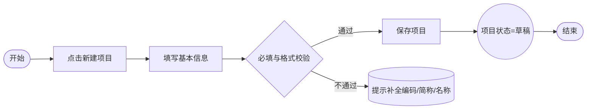

P-02 编辑项目

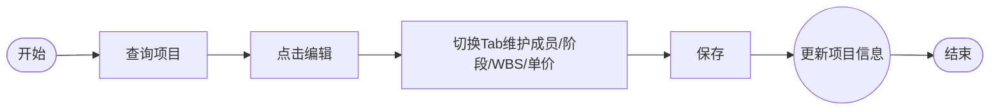

P-03 删除项目

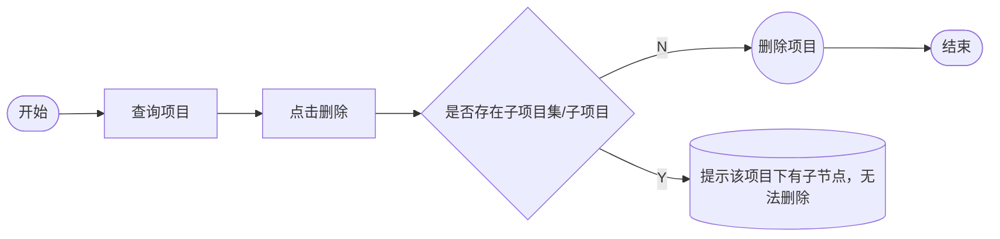

P-04 项目立项

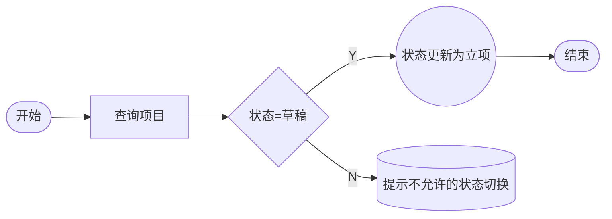

P-05 启动项目

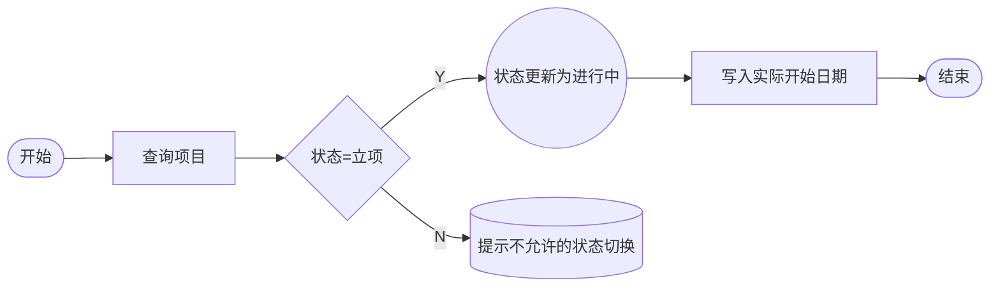

P-06 暂停/恢复/完成/关闭

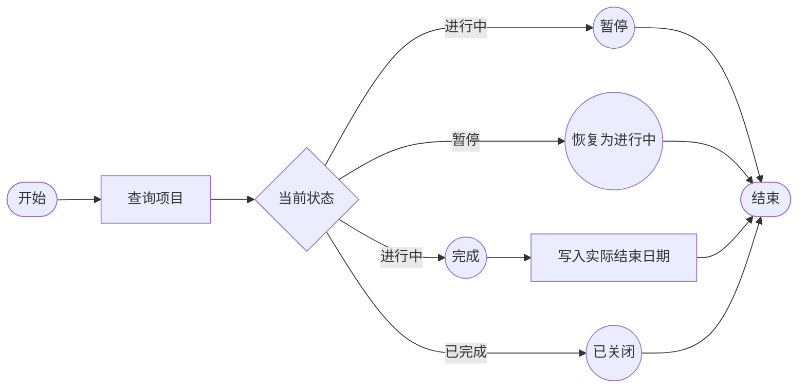

##### 4.2.1.4 业务规则

| 规则编码 | 规则名称 | 规则描述（触发条件；校验逻辑；失败行为） | 规则大类 |
| --- | --- | --- | --- |
| IR-001 | 创建项目 | 项目编码、项目简称、项目名称为必填；缺失时提示"项目编码、项目简称、项目名称为必填"并阻止保存 | 运行业务规则 |
| IR-002 | 编码/名称唯一 | 同一租户下项目编码、项目名称不允许重复，重复时提示并阻止保存 | 运行业务规则 |
| IR-008 | 项目标准单价 | 项目标准单价为必填，默认 200 元/小时；作为成本单价未命中时的兜底单价来源 | 运行业务规则 |
| IR-006 | 状态流转 | 仅允许：草稿→立项、立项→进行中、进行中→暂停、暂停→进行中、进行中→已完成、暂停→已关闭、已完成→已关闭；其他流转提示"不允许从「X」切换到「Y」" | 运行业务规则 |
| IR-009 | 启动联动 | 首次进入「进行中」时写入实际开始日期；进入「已完成」时写入实际结束日期 | 事件订阅规则 |
| IR-005 | 删除项目 | 存在子项目集或子项目时不允许删除，提示"该项目下有子节点，无法删除"；删除需二次确认 | 运行业务规则 |
| IR-004 | 编辑范围 | 新建与编辑共用同一套多 Tab 表单；编辑时回显当前项目数据；切换 Tab 时已填写内容不丢失；项目集与项目使用同一弹窗 | 运行业务规则 |
| IR-007 | 数据范围 | 项目列表仅展示当前用户行级数据范围内的项目；无权限项目不可见、不可编辑 | 运行业务规则 |

##### 4.2.1.5 领域事件

| 领域事件名称 | 事件载荷 | 发布方 | 订阅方及处理逻辑 |
| --- | --- | --- | --- |
| EV001 项目已立项 | 项目 ID（projectId）：String 必填；项目编码（projectCode）：String 必填；项目状态（projectStatus）：String 必填；操作人（operatorId）：String 必填 | 项目聚合 | 1. 审批/通知：推送立项结果给项目经理；2. 经营分析聚合：刷新项目状态分布 |
| EV002 项目已启动 | 项目 ID（projectId）：String 必填；实际开始日期（actualStartDate）：Date 必填；项目经理（managerId）：String 必填 | 项目聚合 | 1. 工时聚合：开放该项目工时填报入口；2. 结算聚合：允许该项目创建结算单 |
| EV003 项目状态变更 | 项目 ID（projectId）：String 必填；原状态（fromStatus）：String 必填；新状态（toStatus）：String 必填；变更时间（occurredAt）：DateTime 必填 | 项目聚合 | 1. 工时聚合：暂停/关闭时禁止新增填报；2. 首页聚合：刷新 KPI 与状态分布 |

##### 4.2.1.6 领域服务

| 领域服务名称 | 入参  | 输出  |
| --- | --- | --- |
| DS001 项目状态流转服务 | 项目 ID、目标状态、操作人 | 流转结果（成功/失败原因）、实际开始/结束日期 |
| DS006 预算使用率计算服务 | 项目预算工时、已发生工时 | 使用率（保留 1 位小数） |

#### 4.2.2 项目成员

##### 4.2.2.1 功能描述

项目成员 Tab 用于维护项目团队，列表展示员工编号、姓名、项目角色、所属部门、资源类型、加入日期、退出日期、状态；支持「+ 添加成员」与「退出」操作。

添加成员表单字段：选择用户（从用户中选择未加入本项目且状态正常的用户）、项目角色、资源类型（内部/外协/供应商）、加入日期、备注。

##### 4.2.2.2 状态定义

成员状态：在职 → 退出。

##### 4.2.2.3 业务流程图

M-01 添加成员

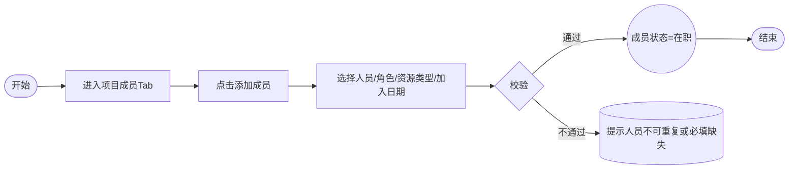

M-02 成员退出

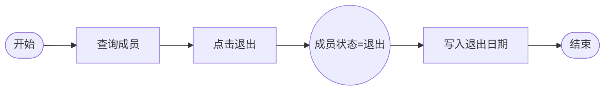

##### 4.2.2.4 业务规则

| 规则编码 | 规则名称 | 规则描述（触发条件；校验逻辑；失败行为） | 规则大类 |
| --- | --- | --- | --- |
| IR-001 | 添加成员 | 人员、项目角色、资源类型、加入日期为必填；缺失时阻止保存 | 运行业务规则 |
| IR-002 | 人员唯一 | 同一项目下同一人员不得重复添加（退出的成员可重新加入） | 运行业务规则 |
| IR-009 | 退出联动 | 退出时写入退出日期，成员状态置为「退出」，不再出现在工时填报可选的成员范围 | 事件订阅规则 |
| IR-003 | 退出前置 | 仅「在职」成员允许执行退出；已退出成员操作列显示"—" | 运行业务规则 |

##### 4.2.2.5 领域事件

| 领域事件名称 | 事件载荷 | 发布方 | 订阅方及处理逻辑 |
| --- | --- | --- | --- |
| EV004 项目成员已变更 | 项目 ID（projectId）：String 必填；成员 ID（memberId）：String 必填；变更类型（changeType）：String 必填（加入/退出）；操作人（operatorId）：String 必填 | 项目聚合 | 1. 工时聚合：刷新可填报成员范围；2. 经营分析聚合：刷新投入人数与成员构成 |

#### 4.2.3 项目阶段

##### 4.2.3.1 功能描述

项目阶段 Tab 用于维护项目阶段计划，列表展示顺序、阶段编码、阶段名称、前置阶段、计划开始、计划结束、实际开始、实际结束、负责人、状态、操作；支持「+ 添加阶段」、详情、编辑、删除。

阶段表单字段：阶段编码、阶段名称、阶段顺序（默认取现有阶段数 +1）、前置阶段（同项目阶段可选）、计划开始日期、计划结束日期、阶段负责人、备注。

##### 4.2.3.2 状态定义

阶段状态：未开始 → 进行中 → 已完成。阶段状态由「阶段自动扫描服务」依据计划与实际时间统一推进，业务操作只负责状态变更，不提供手工改状态入口（页面提示："阶段状态由「阶段自动扫描服务」统一推进，业务操作只负责状态变更"）。

##### 4.2.3.3 业务流程图

PH-01 添加阶段

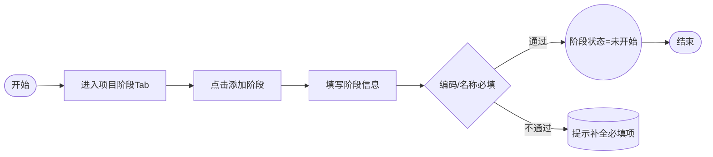

PH-02 删除阶段

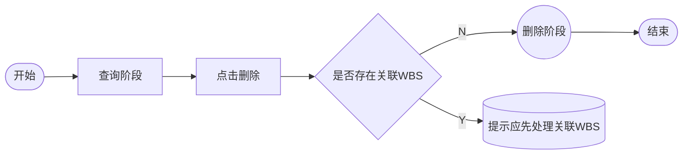

PH-03 阶段自动扫描

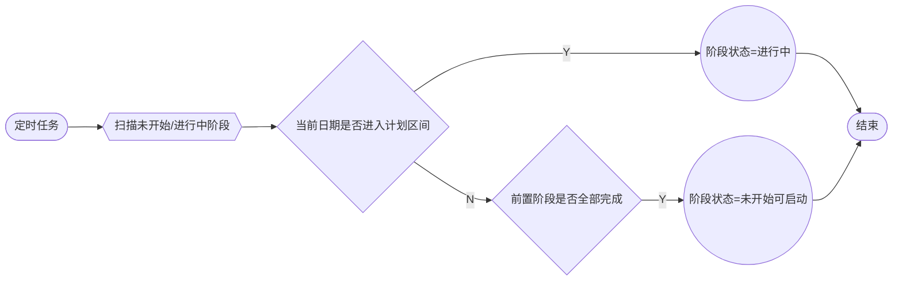

##### 4.2.3.4 业务规则

| 规则编码 | 规则名称 | 规则描述（触发条件；校验逻辑；失败行为） | 规则大类 |
| --- | --- | --- | --- |
| IR-001 | 添加阶段 | 阶段编码、阶段名称必填；计划开始日期不得晚于计划结束日期 | 运行业务规则 |
| IR-002 | 阶段唯一 | 同一项目下阶段编码、阶段名称不允许重复 | 运行业务规则 |
| IR-005 | 前置阶段 | 前置阶段必须为同项目阶段，且不允许形成循环依赖 | 运行业务规则 |
| IR-005 | 删除阶段 | 存在关联 WBS 时不允许删除，提示先删除或迁移关联 WBS | 运行业务规则 |
| IR-006 | 状态推进 | 阶段状态仅由阶段自动扫描服务推进，前端不提供手工修改入口 | 事件订阅规则 |

#### 4.2.4 WBS

##### 4.2.4.1 功能描述

WBS Tab 以树形结构展示项目 WBS（大类/子类/事项三级），列包含名称、类型、预算工时、已产生工时、负责人、配合人、状态、操作；支持「+ 添加WBS」、展开/折叠、填报工时（仅事项）、详情、编辑、删除。

WBS 表单字段：WBS 名称（必填）、所属阶段、父节点、WBS 类型（大类/子类/事项，默认事项）、预算工时、负责人、配合人、计划开始日期、计划结束日期、是否里程碑。

##### 4.2.4.2 状态定义

WBS 状态：未开始 → 进行中 → 已完成。WBS 类型：大类 / 子类 / 事项；仅「事项」级节点允许工时填报。

##### 4.2.4.3 业务流程图

W-01 添加 WBS

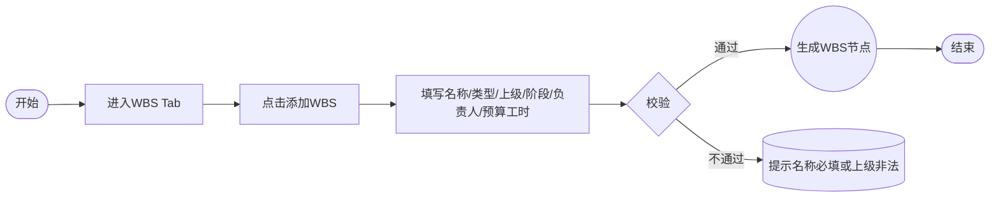

W-02 删除 WBS

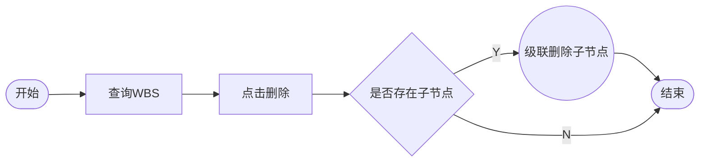

W-03 事项填报工时

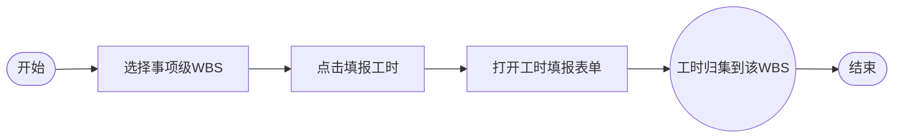

##### 4.2.4.4 业务规则

| 规则编码 | 规则名称 | 规则描述（触发条件；校验逻辑；失败行为） | 规则大类 |
| --- | --- | --- | --- |
| IR-001 | 添加 WBS | WBS 名称、类型为必填；预算工时不得为负数 | 运行业务规则 |
| IR-005 | 层级约束 | 类型为「大类」时上级为空；「子类」上级必须为大类；「事项」上级必须为子类 | 运行业务规则 |
| IR-005 | 删除 WBS | 删除节点时级联删除其子节点，需二次确认；已被工时记录引用的节点不允许删除，提示先处理工时记录 | 运行业务规则 |
| IR-009 | 工时归集 | 工时记录写入后累加 WBS 已产生工时，并同步累加项目已发生工时 | 事件订阅规则 |
| IR-004 | 填报限制 | 仅「事项」类型显示「填报工时」入口；非事项节点不可直接填报 | 运行业务规则 |

#### 4.2.5 成本单价

##### 4.2.5.1 功能描述

成本单价 Tab 用于配置项目内各维度结算单价，列表展示序号、人员（或维度标识）、工时系数、自定义单价、操作；支持「+ 添加单价」、编辑、删除。

成本单价配置字段：人员（必填）、工时系数（默认 1.0，用于工时折算）、自定义单价（必填，元/小时）。列表展示人员（姓名 + 角色）、工时系数、自定义单价，并按配置标识匹配维度（人员 / WBS 专项 / 角色默认 / 项目默认）。

匹配优先级固定为：人员（PERSON） > WBS（WBS） > 角色（ROLE） > 项目默认（PROJECT） > 兜底单价（UNIFIED）。未配置任何命中单价时，使用项目标准单价（默认 200 元/小时）作为兜底。

##### 4.2.5.2 状态定义

成本单价状态：启用 / 停用。仅「启用」状态的单价参与匹配。

##### 4.2.5.3 业务流程图

CR-01 添加成本单价

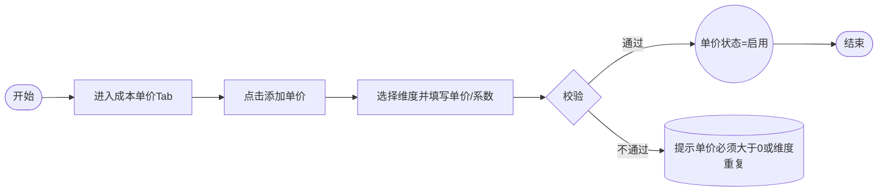

CR-02 结算单价匹配

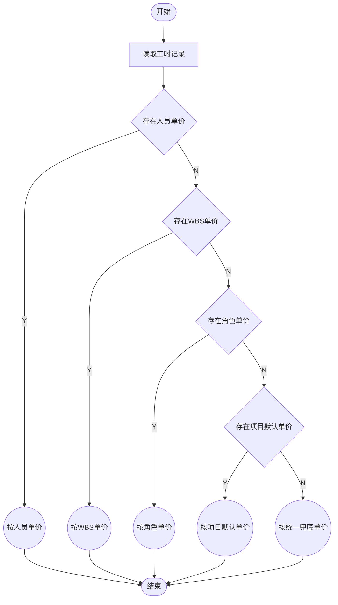

##### 4.2.5.4 业务规则

| 规则编码 | 规则名称 | 规则描述（触发条件；校验逻辑；失败行为） | 规则大类 |
| --- | --- | --- | --- |
| IR-001 | 添加单价 | 自定义单价必填且大于 0；工时系数必须大于 0，默认 1.0 | 运行业务规则 |
| IR-002 | 维度唯一 | 同一项目下同一维度（人员/WBS/角色/项目默认）不允许重复配置 | 运行业务规则 |
| IR-008 | 匹配优先级 | 严格按 PERSON > WBS > ROLE > PROJECT > UNIFIED 顺序取第一个启用单价，命中即返回，不再向下匹配 | 运行业务规则 |
| IR-008 | 兜底单价 | 四类维度均未命中时，使用项目标准单价（默认 200 元/小时）；项目标准单价缺失时使用系统统一结算单价 | 运行业务规则 |
| IR-004 | 删除单价 | 已被结算明细引用的单价不允许删除，提示先作废关联结算单 | 运行业务规则 |

##### 4.2.5.5 领域服务

| 领域服务名称 | 入参  | 输出  |
| --- | --- | --- |
| DS002 成本单价匹配服务 | 项目 ID、人员 ID、WBS ID、角色 ID | 命中单价、匹配类型（PERSON/WBS/ROLE/PROJECT/UNIFIED）、单价配置 ID |

### 4.3 分摊规则

#### 4.3.1 功能描述

分摊规则用于定义成本从来源项目向目标项目的分摊方式。列表支持按「规则名称/编码」查询与重置；列表列包含规则编码、规则名称、来源项目、分摊目标（目标项目 + 比例）、尾差处理、状态、操作；支持「+ 新建分摊规则」、详情、删除。

新建规则表单字段：规则编码、规则名称、来源项目、尾差处理方式（最后目标承担 / 四舍五入 / 忽略尾差）、分摊目标明细（目标项目 + 分摊比例%，可动态添加/移除多行）。

#### 4.3.2 状态定义

规则状态：启用 / 停用。新建规则默认为「启用」，仅启用的规则可被触发分摊。

#### 4.3.3 业务流程图

A-01 创建分摊规则

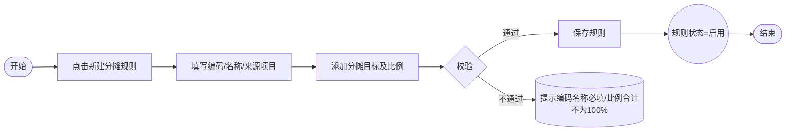

A-02 删除分摊规则

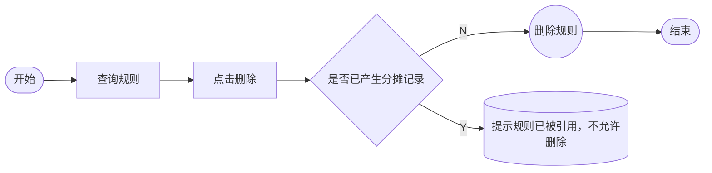

#### 4.3.4 业务规则

| 规则编码 | 规则名称 | 规则描述（触发条件；校验逻辑；失败行为） | 规则大类 |
| --- | --- | --- | --- |
| IR-001 | 创建规则 | 规则编码、规则名称、来源项目为必填，缺失时提示"规则编码和名称为必填项"并阻止保存 | 运行业务规则 |
| IR-002 | 编码唯一 | 同一租户下规则编码不允许重复 | 运行业务规则 |
| IR-008 | 比例校验 | 同一规则下所有分摊目标的固定比例合计必须为 100%；单个目标比例必须大于 0 | 运行业务规则 |
| IR-005 | 目标项目 | 目标项目不可与来源项目相同；同一规则内目标项目不允许重复 | 运行业务规则 |
| IR-008 | 尾差处理 | 最后目标承担：最后一个目标金额 = 总结算金额 − 前面目标金额合计；四舍五入：每个目标金额四舍五入取整；忽略尾差：按比例直接计算，不补齐差额 | 运行业务规则 |
| IR-003 | 触发前置 | 仅「启用」状态的规则可被选择触发；来源项目下无启用规则时提示"该项目无启用的分摊规则" | 运行业务规则 |
| IR-005 | 删除规则 | 已产生分摊明细（含已作废）的规则不允许删除 | 运行业务规则 |

#### 4.3.5 领域事件

| 领域事件名称 | 事件载荷 | 发布方 | 订阅方及处理逻辑 |
| --- | --- | --- | --- |
| EV013 分摊规则已变更 | 规则 ID（ruleId）：String 必填；来源项目（sourceProjectId）：String 必填；变更类型（changeType）：String 必填；操作人（operatorId）：String 必填 | 分摊规则聚合 | 1. 分摊聚合：刷新可触发的规则候选；2. 审计：记录规则变更 |

### 4.4 工时单

#### 4.4.1 工时单列表

##### 4.4.1.1 功能描述

工时单列表用于按周期提交工时。筛选条件为：工时单编号、提交人、提交时间起、提交时间止、审批状态，并提供「重置」「搜索」；列表列包含工时单编号、提交人、提交时间、说明、记录数、总工时、审批状态、操作。

操作能力（按状态区分）：

1. 草稿：提交审批、编辑、作废。
2. 审批中：通过、驳回、查看。
3. 已驳回：重新提交、编辑、作废。
4. 通过/已取消/已作废：查看。

左上角菜单角标展示「草稿 + 审批中」的工时单数量。

##### 4.4.1.2 状态定义

工时单状态：草稿 → 审批中 → 通过；审批中 → 已驳回 → 审批中；草稿/已驳回 → 已取消；草稿/已驳回 → 已作废。

##### 4.4.1.3 业务流程图

T-01 新建工时单并填报

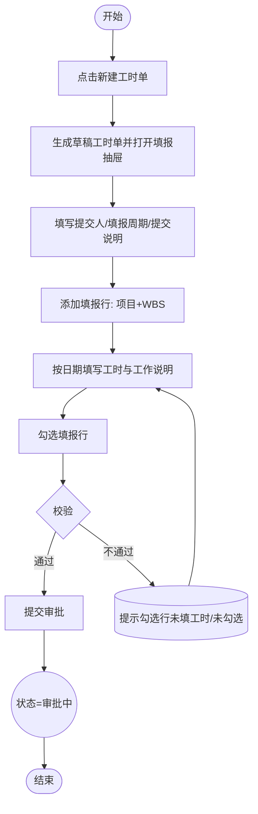

T-02 保存草稿

```mermaid
flowchart LR
    A([开始]) --> B[填报工时] --> C[保存草稿] --> D((状态=草稿)) --> E[关闭抽屉] --> F([结束])
```

T-03 审批通过/驳回

```mermaid
flowchart LR
    A([开始]) --> B[查询审批中工时单] --> C{审批结论}
    C -- 通过 --> D((状态=通过)) --> E[锁定工时记录] --> F([结束])
    C -- 驳回 --> G[填写驳回原因] --> H((状态=已驳回)) --> I[解锁工时记录] --> F
```

T-04 作废

```mermaid
flowchart LR
    A([开始]) --> B[查询草稿/已驳回工时单] --> C[点击作废] --> D[填写作废原因] --> E((状态=已作废)) --> F[回滚项目已发生工时] --> G([结束])
```

#### 4.4.2 工时填报表单（新建/编辑/查看一体）

##### 4.4.2.1 功能描述

工时单以宽抽屉承载，将「创建表单」与「日历格子填报」合并为同一界面：

1. 顶部创建表单（新建模式显示）：提交人（下拉选择用户）、工时单编号（只读）、填报周期开始、填报周期结束、提交说明。
2. 中部状态信息（查看模式显示）：提交人、记录数、总工时、状态、状态流转条、驳回/审批中/通过等提示。
3. 下方日历填报区：左侧固定列为「项目」「计划名称（WBS）」，右侧按填报周期逐日生成日期列（显示月-日与星期，周末与今日高亮）；每个日期格包含工时输入（0~24，步长 0.5）与工作说明输入。
4. 表格底部为「日合计」行；表格下方汇总「填报行 / 记录数 / 总工时」。
5. 「＋ 添加行」打开「添加填报行」弹窗：项目仅可选择「进行中」的项目，计划名称（WBS）下拉联动所选项目；行尾「✕」可删除填报行。
6. 勾选列用于选择本次要提交的填报行；表头复选框支持全选/反选。
7. 底部按钮：新建模式为「取消 / 保存草稿 / 提交审批」；查看模式为「关闭 / 保存草稿 / 提交审批」（可编辑时）或审批操作（审批中时显示「驳回 / 通过审批」）。

##### 4.4.2.2 状态定义

同 4.4.1.2。表单可编辑性：草稿、已驳回可编辑；审批中、通过、已取消、已作废只读。

##### 4.4.2.3 业务流程图

T-05 修改填报周期

```mermaid
flowchart LR
    A([开始]) --> B[修改周期开始/结束] --> C{结束日期早于开始日期}
    C -- Y --> D[(提示周期不合法)] --> E([结束])
    C -- N --> F[重建日期列] --> G[保留已有工时记录] --> E
```

T-06 单元格录入

```mermaid
flowchart LR
    A([开始]) --> B[输入工时] --> C{0<=工时<=24且为0.5倍数}
    C -- Y --> D[写入/更新工时记录] --> E[刷新日合计与总工时] --> F([结束])
    C -- N --> G[(修正为合法数值)]
```

##### 4.4.2.4 业务规则

| 规则编码 | 规则名称 | 规则描述（触发条件；校验逻辑；失败行为） | 规则大类 |
| --- | --- | --- | --- |
| IR-001 | 新建工时单 | 提交人、填报周期开始、填报周期结束为必填；结束日期不得早于开始日期，否则提示"填报周期结束日期不能早于开始日期" | 运行业务规则 |
| IR-002 | 单号生成 | 工时单编号由系统按 TS-年份-序号 规则自动生成，只读不可修改 | 运行业务规则 |
| IR-004 | 可编辑范围 | 仅草稿、已驳回状态允许编辑工时与说明；审批中、通过、已取消、已作废只读 | 运行业务规则 |
| IR-008 | 工时取值 | 单格工时取值范围 0~24，步长 0.5；日合计 = 当日全部填报行工时之和 | 运行业务规则 |
| IR-001 | 提交校验 | 提交时必须至少勾选一行，未勾选提示"请先勾选要提交的填报行" | 运行业务规则 |
| IR-001 | 空行校验 | 勾选行中若存在未填写任何工时的行，提示"勾选的行中存在未填写工时的行，请检查"并阻止提交 | 运行业务规则 |
| IR-006 | 提交流转 | 提交后状态由草稿/已驳回变为审批中，工时记录锁定（is_lock=true），不可再编辑 | 运行业务规则 |
| IR-006 | 审批流转 | 审批通过后状态变为通过；驳回必须填写原因，状态变为已驳回并解锁工时记录 | 运行业务规则 |
| IR-003 | 作废前置 | 仅草稿、已驳回状态允许作废；作废必须填写原因，作废后回滚项目已发生工时 | 运行业务规则 |
| IR-009 | 工时累计 | 工时记录新增/修改/删除时，同步维护工时单记录数与总工时，并累加/回滚项目已发生工时 | 事件订阅规则 |
| IR-005 | 项目/WBS 约束 | 填报行只能选择「进行中」的项目；WBS 必须属于所选项目 | 运行业务规则 |
| IR-007 | 填报权限 | 仅项目成员可对所属项目填报；审批仅审批人/项目经理可操作 | 运行业务规则 |

##### 4.4.2.5 领域事件

| 领域事件名称 | 事件载荷 | 发布方 | 订阅方及处理逻辑 |
| --- | --- | --- | --- |
| EV005 工时单已提交 | 工时单 ID（timesheetId）：String 必填；提交人（submitterId）：String 必填；周期起止（periodStart/periodEnd）：Date 必填；记录数（recordCount）：Number 必填；总工时（totalHours）：Decimal 必填 | 工时单聚合 | 1. 审批聚合：创建审批实例并推送待办；2. 项目聚合：累加项目已发生工时；3. 首页：刷新待处理工时单数量 |
| EV006 工时单审批通过 | 工时单 ID（timesheetId）：String 必填；项目 ID（projectId）：String 必填；总工时（totalHours）：Decimal 必填；通过时间（approvedAt）：DateTime 必填 | 工时单聚合 | 1. 工时记录聚合：锁定记录；2. 结算聚合：将记录纳入可结算范围 |
| EV007 工时单已驳回 | 工时单 ID（timesheetId）：String 必填；驳回原因（reason）：String 必填；审批人（approverId）：String 必填 | 工时单聚合 | 1. 工时记录聚合：解锁记录；2. 通知：推送驳回原因给提交人 |
| EV008 工时单已作废 | 工时单 ID（timesheetId）：String 必填；作废原因（reason）：String 必填；回滚工时（rollbackHours）：Decimal 必填 | 工时单聚合 | 1. 项目聚合：回滚已发生工时；2. WBS 聚合：回滚已产生工时 |
| EV009 工时记录已归集 | 记录 ID（recordId）：String 必填；项目 ID、WBS ID、人员 ID、工作日期、工时 | 工时记录聚合 | 1. WBS 聚合：累加已产生工时；2. 项目聚合：刷新预算使用率 |

##### 4.4.2.6 领域服务

| 领域服务名称 | 入参  | 输出  |
| --- | --- | --- |
| DS003 工时校验服务 | 工时单 ID、勾选行集合、工时记录集合 | 校验结果（未勾选/空行/超限）、可提交标记 |
| DS007 工时汇总服务 | 工时单 ID | 记录数、总工时、日合计序列 |

### 4.5 工时记录

#### 4.5.1 功能描述

工时记录为只读台账，用于跨工时单查询明细。筛选条件为：项目、人员、工作日期起、工作日期止，支持查询/重置与分页（每页 10 条）。列表列包含记录编号、填报人、工作日期、项目、WBS、工时、工作说明、所属工时单、单据状态；点击工时单编号可打开对应工时单详情。

页面提示："工时记录为只读查看列表。新增和编辑工时记录请在工时单详情中操作。"

#### 4.5.2 状态定义

无独立状态，展示所属工时单状态（草稿/审批中/通过/已驳回/已取消/已作废）。

#### 4.5.3 业务流程图

TR-01 查询工时记录

```mermaid
flowchart LR
    A([开始]) --> B[选择项目/人员/日期区间] --> C[点击查询] --> D[按条件过滤] --> E[分页渲染] --> F([结束])
```

#### 4.5.4 业务规则

| 规则编码 | 规则名称 | 规则描述（触发条件；校验逻辑；失败行为） | 规则大类 |
| --- | --- | --- | --- |
| IR-001 | 日期区间 | 结束日期不得早于开始日期；命中 0 条时展示"暂无符合条件的工时记录" | 运行业务规则 |
| IR-007 | 只读与数据范围 | 工时记录不可在本页新增/编辑/删除；仅展示当前用户数据范围内记录 | 运行业务规则 |
| IR-008 | 分页  | 每页 10 条，展示当前页区间与总条数，页码支持前后翻页 | 运行业务规则 |

### 4.6 结算单

#### 4.6.1 功能描述

结算单用于按项目、周期将已审批工时记录转化为成本与结算金额。筛选条件为：结算名称、项目、状态，并提供「重置」「搜索」；列表列包含结算单编号、结算名称、项目、结算周期、工时记录数、总工时、成本总额、结算系数、结算金额、状态、操作。

创建结算单弹窗字段：选择项目（仅「进行中」项目）、结算开始日期、结算结束日期、结算名称、结算系数（默认 1.0）、币种（CNY/USD）。弹窗内实时展示结算预览：匹配工时记录数、总工时、预估成本，以及明细（日期、人员、WBS、工时、匹配类型、单价、金额）。

列表操作：草稿→提交审批/取消；审批中→通过/不通过；不通过→取消；已结算→作废；全部状态可查看详情。

详情抽屉展示：结算单名称、所属项目、结算周期、结算状态、确认状态、状态流转条、成本匹配策略可视化、结算明细列表。

#### 4.6.2 状态定义

结算单状态：草稿 → 审批中 → 已结算；审批中 → 不通过；草稿/不通过 → 已取消；已结算 → 已作废。

确认状态：未确认 → 已确认（审批通过时写入确认人与确认时间）。

#### 4.6.3 业务流程图

S-01 创建结算单

```mermaid
flowchart TD
    A([开始]) --> B[点击创建结算单] --> C[选择项目/周期/名称/系数/币种] --> D[系统提取已审批工时记录] --> E{存在可结算记录}
    E -- N --> F[(提示该日期范围内没有已审批的工时记录)]
    E -- Y --> G[按优先级匹配单价] --> H[计算明细金额与成本总额] --> I[结算金额=成本总额×系数] --> J((状态=草稿)) --> K([结束])
```

S-02 提交/通过/不通过

```mermaid
flowchart LR
    A([开始]) --> B[草稿结算单] --> C[提交审批] --> D((状态=审批中))
    D --> E{审批结论}
    E -- 通过 --> F((状态=已结算)) --> G[写入确认人/确认时间] --> H([结束])
    E -- 不通过 --> I[填写不通过原因] --> J((状态=不通过)) --> H
```

S-03 取消/作废

```mermaid
flowchart LR
    A([开始]) --> B[查询结算单] --> C{状态}
    C -- 草稿/不通过 --> D[填写取消原因] --> E((状态=已取消)) --> F([结束])
    C -- 已结算 --> G[填写作废原因] --> H((状态=已作废)) --> I[联动作废分摊明细] --> F
```

#### 4.6.4 业务规则

| 规则编码 | 规则名称 | 规则描述（触发条件；校验逻辑；失败行为） | 规则大类 |
| --- | --- | --- | --- |
| IR-001 | 创建结算单 | 项目、开始日期、结束日期、结算名称为必填；结算名称缺失提示"结算名称为必填" | 运行业务规则 |
| IR-003 | 项目范围 | 仅「进行中」的项目允许创建结算单 | 运行业务规则 |
| IR-001 | 记录校验 | 所选项目与日期范围内必须存在「通过」状态的工时记录，否则提示"该日期范围内没有已审批的工时记录" | 运行业务规则 |
| IR-008 | 单价匹配 | 每条明细按 PERSON > WBS > ROLE > PROJECT > UNIFIED 顺序匹配单价 | 运行业务规则 |
| IR-008 | 金额计算 | 明细金额 = 工时 × 单价；成本总额 = Σ明细金额；结算金额 = 成本总额 × 结算系数，保留 2 位小数 | 运行业务规则 |
| IR-002 | 编号生成 | 结算单编号按 STL-年份-序号 自动生成，只读 | 运行业务规则 |
| IR-006 | 审批流转 | 仅草稿可提交；仅审批中可通过/不通过；不通过必须填写原因 | 运行业务规则 |
| IR-003 | 取消前置 | 仅草稿、不通过可取消，取消必须填写原因 | 运行业务规则 |
| IR-003 | 作废前置 | 仅已结算可作废；作废必须填写原因 | 运行业务规则 |
| IR-009 | 作废联动 | 作废结算单时，联动作废其全部已完成分摊明细，并写入作废原因 | 事件订阅规则 |
| IR-004 | 可编辑性 | 草稿状态可编辑；审批中及之后状态不可修改结算明细 | 运行业务规则 |

#### 4.6.5 领域事件

| 领域事件名称 | 事件载荷 | 发布方 | 订阅方及处理逻辑 |
| --- | --- | --- | --- |
| EV010 结算单已结算 | 结算单 ID（settlementId）：String 必填；项目 ID（projectId）：String 必填；周期起止：Date 必填；总工时（totalHours）：Decimal 必填；结算金额（rateAmount）：Decimal 必填；确认人（confirmedBy）：String 必填 | 结算聚合 | 1. 分摊聚合：开放该结算单的分摊触发入口；2. 经营分析聚合：汇总结算金额；3. 项目聚合：归集项目成本 |
| EV011 结算单已作废 | 结算单 ID（settlementId）：String 必填；作废原因（reason）：String 必填；操作人（operatorId）：String 必填 | 结算聚合 | 1. 分摊聚合：联动作废关联分摊明细；2. 经营分析聚合：冲减结算金额 |
| EV012 结算单审批不通过 | 结算单 ID（settlementId）：String 必填；原因（reason）：String 必填；审批人（approverId）：String 必填 | 结算聚合 | 通知：推送不通过原因给创建人 |

#### 4.6.6 领域服务

| 领域服务名称 | 入参  | 输出  |
| --- | --- | --- |
| DS004 结算生成服务 | 项目 ID、周期起止、结算名称、结算系数、币种 | 结算单（草稿）、结算明细、成本总额、结算金额 |
| DS002 成本单价匹配服务 | 项目 ID、人员 ID、WBS ID、角色 ID | 命中单价与匹配类型 |

### 4.7 分摊记录

#### 4.7.1 功能描述

分摊记录用于将已结算结算单的成本按规则分摊至目标项目。筛选条件为「来源项目」，提供「重置」「搜索」。

页面包含「触发分摊」区块：选择已结算的结算单 + 选择该来源项目下启用的分摊规则，点击「触发分摊」生成分摊明细。

分摊记录列表列包含：分摊明细编号、来源结算单、来源项目、目标项目、分摊方式、分摊比例、分摊工时、分摊金额、状态、分摊时间、操作；状态为「已完成」时显示「作废」，已作废记录展示作废原因。

页面提示："分摊记录通过触发按钮生成。选择已结算的结算单和对应的分摊规则，系统自动按规则比例计算分摊金额。"；无已结算结算单时提示"暂无已结算的结算单，无法触发分摊"。

#### 4.7.2 状态定义

分摊明细状态：已完成 → 已作废。分摊方式：按金额（预算）。

#### 4.7.3 业务流程图

R-01 触发分摊

```mermaid
flowchart TD
    A([开始]) --> B[选择已结算结算单] --> C[加载来源项目启用规则] --> D[选择分摊规则] --> E{该结算单是否已按此规则生成}
    E -- Y --> F[(提示已生成过分摊记录)]
    E -- N --> G[按目标比例计算分摊工时与金额] --> H{尾差处理}
    H -- 最后目标承担 --> I[末目标取差额]
    H -- 四舍五入 --> J[金额四舍五入]
    H -- 忽略尾差 --> K[按比例直算]
    I --> L((生成分摊明细=已完成))
    J --> L
    K --> L
    L --> M([结束])
```

R-02 作废分摊明细

```mermaid
flowchart LR
    A([开始]) --> B[查询已完成分摊明细] --> C[点击作废] --> D[填写作废原因] --> E((状态=已作废)) --> F([结束])
```

#### 4.7.4 业务规则

| 规则编码 | 规则名称 | 规则描述（触发条件；校验逻辑；失败行为） | 规则大类 |
| --- | --- | --- | --- |
| IR-003 | 触发前置 | 仅「已结算」状态的结算单可触发分摊；结算单与规则均必填，缺失提示"请选择结算单和分摊规则" | 运行业务规则 |
| IR-002 | 防重复触发 | 同一结算单同一规则已存在「已完成」分摊明细时，提示"该结算单已按此规则生成过分摊记录"并阻止 | 运行业务规则 |
| IR-008 | 分摊计算 | 分摊金额 = 结算金额 × 分摊比例；分摊工时 = 结算单总工时 × 分摊比例，工时保留 1 位小数 | 运行业务规则 |
| IR-008 | 尾差处理 | 按规则配置执行：最后目标承担（末目标 = 总额 − 已分摊额）、四舍五入（金额取整）、忽略尾差（不补齐） | 运行业务规则 |
| IR-005 | 规则匹配 | 仅可加载来源项目与结算单项目一致且状态为「启用」的规则 | 运行业务规则 |
| IR-003 | 作废前置 | 仅「已完成」分摊明细可作废，作废必须填写原因 | 运行业务规则 |
| IR-007 | 操作权限 | 仅财务人员/租户管理员可触发分摊与作废 | 运行业务规则 |

#### 4.7.5 领域事件

| 领域事件名称 | 事件载荷 | 发布方 | 订阅方及处理逻辑 |
| --- | --- | --- | --- |
| EV014 分摊已执行 | 分摊明细 ID（allocationDetailId）：String 必填；来源结算单（sourceSettlementOrderId）：String 必填；来源项目/目标项目：String 必填；分摊比例（allocationRatio）：Decimal 必填；分摊工时（allocationHours）：Decimal 必填；分摊金额（allocationAmount）：Decimal 必填；规则 ID（ruleId）：String 必填 | 分摊聚合 | 1. 目标项目聚合：归集分摊工时与成本；2. 经营分析聚合：刷新目标项目投入与成本 |
| EV015 分摊明细已作废 | 分摊明细 ID：String 必填；作废原因（voidReason）：String 必填；操作人（operatorId）：String 必填 | 分摊聚合 | 1. 目标项目聚合：冲减分摊工时与成本；2. 经营分析聚合：刷新统计 |

#### 4.7.6 领域服务

| 领域服务名称 | 入参  | 输出  |
| --- | --- | --- |
| DS005 分摊计算服务 | 结算单 ID、规则 ID、分摊目标集合、尾差处理方式 | 分摊明细集合（工时、金额、比例、状态） |

### 4.8 经营分析

#### 4.8.1 功能描述

经营分析按四个维度提供投入产出视图，均支持统计周期、项目、项目类型、部门、人员等筛选条件。

1. 经营总览：KPI 为总投入工时、可结算工时（占比）、工时成本、结算金额、人均工时；支持趋势指标切换（实际工时/计划工时/可结算工时/成本）；图表包含工时趋势、工时结构（阶段饼图）、项目投入 TOP5（可按实际工时/投入人数切换）与成本/结算分析。
2. 项目分析：KPI 为项目数、计划工时、实际工时、工时成本、平均可结算率；列表展示项目、项目类型、所属部门、负责人、计划工时、实际工时、偏差、投入人数、成本、结算金额、可结算率，支持点击查看项目详情。
3. 组织分析：KPI 为部门数、总人数、总工时、人均工时、总成本；列表展示部门维度人数、总工时、人均工时、成本与可结算率，并提供部门工时对比图。
4. 人员分析：KPI 为人员数、总工时、人均工时、总成本、平均可结算率；列表展示人员、部门、参与项目、实际工时、计划工时、偏差、成本、可结算率，支持点击查看人员详情（按项目拆分）。

#### 4.8.2 状态定义

只读分析页面，无业务状态；数据口径依赖工时单「通过」与结算单「已结算」状态。

#### 4.8.3 业务流程图

B-01 经营分析查询

```mermaid
flowchart LR
    A([开始]) --> B[选择统计周期与维度筛选] --> C[汇总工时/成本/结算数据] --> D[计算人均与占比指标] --> E[渲染KPI/图表/明细] --> F([结束])
```

#### 4.8.4 业务规则

| 规则编码 | 规则名称 | 规则描述（触发条件；校验逻辑；失败行为） | 规则大类 |
| --- | --- | --- | --- |
| IR-008 | 统计口径 | 投入工时取「通过」状态工时记录；可结算工时取已结算明细；工时成本 = Σ(工时 × 匹配单价)；结算金额取已结算结算单 | 运行业务规则 |
| IR-008 | 人均指标 | 人均工时 = 总工时 ÷ 投入人数，保留 1 位小数；人数为 0 时返回 0 | 运行业务规则 |
| IR-008 | 偏差与占比 | 项目偏差 = 实际工时 − 计划工时；可结算率 = 可结算工时 ÷ 实际工时 × 100% | 运行业务规则 |
| IR-007 | 数据范围 | 分析数据受当前用户行级数据范围约束 | 运行业务规则 |
| IR-009 | 数据时效 | 工时单审批通过、结算单结算、分摊执行后刷新分析数据 | 事件订阅规则 |

### 4.9 权限管理

#### 4.9.1 功能描述

权限管理包含两个页面：

1. RBAC·功能权限：页面包含「角色管理」「菜单与页面」「操作按钮」三个页签。角色管理展示角色、说明、成员数、菜单数、按钮数；菜单与页面、操作按钮以「角色 × 菜单/按钮」矩阵方式授权，勾选即授权。角色包含租户管理员、项目经理、部门负责人、项目成员、审批人、财务人员；租户管理员默认全选且不可取消。
2. 行级权限·数据范围：以「角色 → 资源 → 数据范围」方式授权，资源页签包含项目、项目阶段、WBS 任务、工时记录、结算单；数据范围模式按资源差异化（如全部数据、本人负责、本人参与配合、所属项目可见、本部门、本人管理的部门、WBS 上级链/下级子树、本人填写的工时等），同一资源可多选，生效时取并集。

已下线的菜单（Casbin 操作权限、系统参数、工作日历）不纳入权限矩阵。

#### 4.9.2 状态定义

授权状态：已授权 / 未授权；数据范围模式为枚举值，无流转状态。

#### 4.9.3 业务流程图

PERM-01 功能权限配置

```mermaid
flowchart LR
    A([开始]) --> B[选择角色] --> C[勾选菜单/按钮] --> D{是否租户管理员}
    D -- Y --> E[(全部勾选且不可取消)]
    D -- N --> F[保存授权] --> G[下次登录生效] --> H([结束])
```

PERM-02 行级权限配置

```mermaid
flowchart LR
    A([开始]) --> B[选择角色] --> C[选择资源] --> D[选择数据范围模式] --> E[保存] --> F[按SQL条件过滤数据] --> G([结束])
```

#### 4.9.4 业务规则

| 规则编码 | 规则名称 | 规则描述（触发条件；校验逻辑；失败行为） | 规则大类 |
| --- | --- | --- | --- |
| IR-007 | 管理员保护 | 租户管理员角色的菜单与按钮权限默认全选且不可取消 | 运行业务规则 |
| IR-007 | 最小授权 | 未勾选的菜单不出现在导航中；未勾选的按钮不展示且接口拒绝 | 运行业务规则 |
| IR-007 | 数据范围叠加 | 同一用户多角色时，行级数据范围取并集；功能权限取并集 | 运行业务规则 |
| IR-007 | 多选并集 | 同一角色同一资源可选择多个数据范围，最终过滤条件取并集；「全部数据」与其他范围互斥，选中全部即视为不受限 | 运行业务规则 |

### 4.10 领域事件与领域服务汇总

#### 4.10.1 领域事件汇总

| 事件编码 | 事件名称 | 发布方 | 主要订阅方 |
| --- | --- | --- | --- |
| EV001 | 项目已立项 | 项目聚合 | 通知、经营分析 |
| EV002 | 项目已启动 | 项目聚合 | 工时聚合、结算聚合 |
| EV003 | 项目状态变更 | 项目聚合 | 工时聚合、首页 |
| EV005 | 工时单已提交 | 工时单聚合 | 审批聚合、项目聚合 |
| EV006 | 工时单审批通过 | 工时单聚合 | 工时记录聚合、结算聚合 |
| EV007 | 工时单已驳回 | 工时单聚合 | 工时记录聚合、通知 |
| EV008 | 工时单已作废 | 工时单聚合 | 项目聚合、WBS 聚合 |
| EV009 | 工时记录已归集 | 工时记录聚合 | WBS 聚合、项目聚合 |
| EV010 | 结算单已结算 | 结算聚合 | 分摊聚合、经营分析 |
| EV011 | 结算单已作废 | 结算聚合 | 分摊聚合、经营分析 |
| EV012 | 结算单审批不通过 | 结算聚合 | 通知  |
| EV013 | 分摊规则已变更 | 分摊规则聚合 | 分摊聚合、审计 |
| EV014 | 分摊已执行 | 分摊聚合 | 目标项目聚合、经营分析 |
| EV015 | 分摊明细已作废 | 分摊聚合 | 目标项目聚合、经营分析 |

#### 4.10.2 领域服务汇总

| 服务编码 | 服务名称 | 所属模块 | 输出  |
| --- | --- | --- | --- |
| DS001 | 项目状态流转服务 | 项目管理 | 流转结果、实际起止日期 |
| DS002 | 成本单价匹配服务 | 成本单价 | 命中单价、匹配类型、单价配置 ID |
| DS003 | 工时校验服务 | 工时单 | 校验结果、可提交标记 |
| DS004 | 结算生成服务 | 结算单 | 结算单（草稿）、结算明细、金额 |
| DS005 | 分摊计算服务 | 分摊记录 | 分摊明细集合 |
| DS006 | 预算使用率计算服务 | 首页  | 使用率 |
| DS007 | 工时汇总服务 | 工时单 | 记录数、总工时、日合计 |

### 4.11 关键数据字典（摘要）

| 实体  | 关键字段 | 取值/说明 |
| --- | --- | --- |
| 项目  | project_code / project_name / data_type / project_status / standard_price | data_type：项目、项目集；project_status：草稿、立项、进行中、暂停、已完成、已关闭；standard_price 默认 200 |
| 项目成员 | project_role / resource_type / member_status | resource_type：内部、外协、供应商；member_status：在职、退出 |
| 项目阶段 | phase_code / phase_order / pre_phase_id / phase_status | phase_status：未开始、进行中、已完成 |
| WBS | wbs_type / parent_id / milestone_flag / status | wbs_type：大类、子类、事项；status：未开始、进行中、已完成 |
| 成本单价 | userId / wbsId / roleId / unitPrice / coefficient / status | 维度互斥（人员/WBS/角色/项目默认），原型以人员维度维护；status：启用、停用 |
| 分摊规则 | ruleNo / sourceProjectId / roundingAdjustmentType / status | 尾差：最后目标承担、四舍五入、忽略尾差；status：启用、停用 |
| 分摊目标 | ruleId / targetProjectId / fixedRatio | fixedRatio 合计 100 |
| 工时单 | submissionNo / submitterId / periodStart / periodEnd / status / recordCount / totalHours | status：草稿、审批中、通过、已驳回、已取消、已作废 |
| 工时记录 | timesheetSubmissionId / workDate / projectId / wbsId / hours / description / is_lock | 单条工时 0~24，步长 0.5 |
| 结算单 | settlementNo / projectId / periodStart / periodEnd / settlementFactor / totalAmount / rateAmount / status | status：草稿、审批中、已结算、不通过、已取消、已作废 |
| 结算明细 | settlementOrderId / timesheetRecordId / matchType / unitPrice / hours / amount | matchType：PERSON、WBS、ROLE、PROJECT、UNIFIED |
| 分摊明细 | allocationDetailNo / sourceSettlementOrderId / targetProjectId / allocationRatio / allocationHours / allocationAmount / allocationStatus | allocationStatus：已完成、已作废 |
